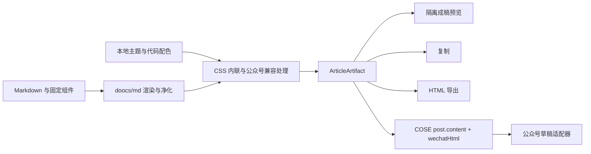

# 架构与验收

## 结构选择

采用单个 pnpm workspace，保留 doocs/md Web 编辑器及其 core、shared、config 包；COSE 作为可在本地修改的源码快照放入 `vendor/cose`。上游不是 Git 子模块，无需依赖隐式分支或在克隆后额外拉取子模块。两个上游的提交 SHA 固定在 `upstream.lock.json`。

新增功能集中于 `packages/article-kit`、`ArticleStudioDialog.vue` 和 `services/publish`。对上游的有限改动包括注册本地组件、注入排版 CSS、代码主题改为本地资源、关闭统计和云服务默认入口、合并成稿管线，以及 COSE 直传支持。

## 单一成稿管线

普通即时预览继续使用 doocs/md 的高性能页面渲染。公众号成稿预览在隔离 iframe 中展示同一内联 HTML，便于检验离开编辑器页面后样式是否仍成立。每次打开成稿、复制、导出或打开发布面板均重新生成；已打开的成稿是快照，修改后需要重新生成。

生成过程等待异步图表、公式与代码高亮。存在未完成内容时明确报错，避免静默省略内容；本地代码主题加载失败时也明确报错。编辑过程中正文变化会使正在生成的成稿失效。

## COSE 直传协议

原版 COSE 为部分富文本平台主动点击复制按钮并读取剪贴板。此仓库在 `addTask` 中增加可选 `post.wechatHtml`：有该字段时直接传入平台消息，没有时保持原有行为。编辑器始终同时传递 `post.content` 和 `post.wechatHtml`，二者均为成稿 HTML，`post.markdown` 仍保留原 Markdown。

扩展平台脚本保持原有协议；公众号适配器继续负责定位正文编辑器、注入 HTML 与草稿保存。浏览器权限、登录态和平台改版问题仍需要在真实浏览器中验证。桥接 API 仅向本地 `http://127.0.0.1`、`http://localhost` 和上游 `https://md.doocs.org` 页面暴露；平台登录检测的原有辅助逻辑保留。

## 固定组件规范

组件定义使用显式内联颜色、间距与结构，不通过浏览器偏好替换模板。v1 导读、结论、方法块支持 Markdown 子内容，其他组件以转义后的属性填充。`markdownChildren` 是新增的可选定义字段，未启用时保留上游原有 HTML children 行为。

为稳定历史排版，不直接改变已发布的 v1 模板；新增 v2，并在文章中显式使用 v2 名称。文章级完整版本锁定、附件资产管理、导出包清单与自动视觉差异报告可作为后续扩展。目前普通正文使用当前全局主题，并非每篇文章独立锁定主题。

## 验收顺序

1. 本地：检查默认文章、主题切换、代码配色、Mac 标题栏与行号；检查自动保存与重载。
2. 管线：检查成稿不依赖外部 CSS；表格、代码高亮和组件保留；与复制、导出和协议提交的 HTML 相同。
3. 公众号草稿：使用演示文章，检查标题正文分离、全部图片转存、手机 375px / 390px 宽度下表格与代码、引用、图注。
4. 公众号手机预览：至少检查一次浅色与深色系统主题；修改平台清洗不兼容项。
5. 其他平台：逐个平台记录支持的标签、CSS 与 Markdown 扩展；无法保持样式的组件提供图片或原生 Markdown 降级方案，验收通过后再标记为支持保真。

本次自动化不向真实平台写入。COSE 消息桥通过真实上游 inject.js 加本地模拟响应验证；UI 分发流程采用本地协议桩。真实平台验收需使用用户自己的登录会话。

## 上游更新

先在临时目录拉取上游，与 `upstream.lock.json` 中的版本比较；重点复核上面列出的本地改动。更新来源 SHA 后运行语义测试、上游回归、类型检查与全部构建，再重复公众号草稿验收。保留所有上游版权与许可文件。
